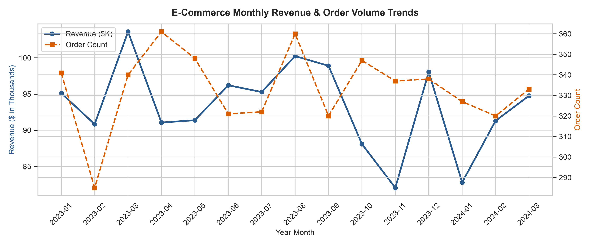
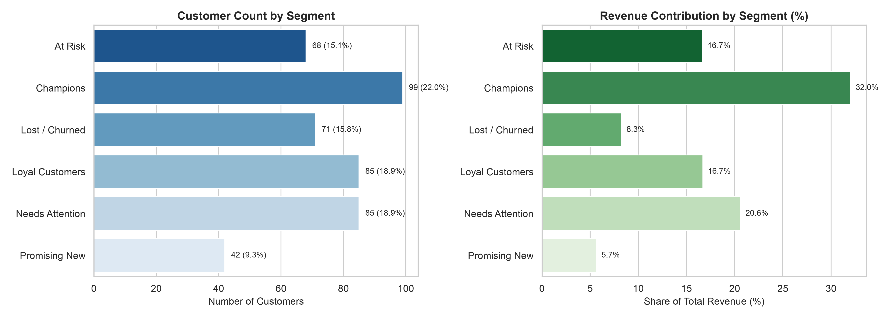
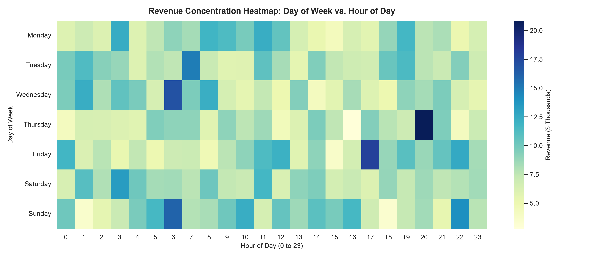

# 🛒 E-Commerce Sales Trend & Customer Churn Analysis

**Organization / Program:** Intern Circle  
**Track:** Data Science & Machine Learning  
**Project:** Project 03 — Customer Churn / Sales Trend Analysis  

---

## 📌 Project Overview
An end-to-end commercial business intelligence and customer behavior analysis pipeline built with **Pandas**, **NumPy**, **Matplotlib**, and **Seaborn**.

This project analyzes over 5,000 transaction records across 450 unique customers. It performs automated temporal date feature extraction, evaluates month-over-month (MoM) revenue growth, computes multi-dimensional category and regional pivot tables, executes **RFM (Recency, Frequency, Monetary) Customer Segmentation**, identifies customer churn risk, and generates actionable commercial growth recommendations.

---

## 🎯 Requirements & Deliverables

| Requirement | Implementation Details | Status |
| :--- | :--- | :---: |
| **Feature Engineering & Date Extraction** | Extracted `Year`, `Month`, `Month_Name`, `Year_Month`, `Quarter`, `Day_of_Week`, `Day_Name`, `Hour`, `Is_Weekend` | ✅ Complete |
| **Pivot Tables & Trend Calculations** | Monthly revenue and order volume trends, MoM growth %, Category vs. Quarter pivot tables, Regional revenue vs. Payment methods | ✅ Complete |
| **RFM Segmentation & Churn Detection** | Dynamic snapshot calculation, quantile scoring (R, F, M), segment classification (*Champions, Loyalists, At Risk, Churned*), 90-day inactivity churn tracking | ✅ Complete |
| **Visual BI Dashboards** | Dual-axis revenue/order trends, RFM segment distribution & revenue share, Day-Hour checkout intensity heatmap | ✅ Complete |
| **Actionable Recommendations** | Strategic business action brief prioritizing high-LTV VIP retention, automated win-back sequences, and campaign scheduling | ✅ Complete |

---

## 📊 Summary of Key Findings

- **Top Revenue Driver:** The **Champions** segment accounts for **~22% of customers** but drives over **32% of total gross revenue** with an average customer spend of **\$4,530.92**.
- **Customer Churn Rate:** Approximately **11.1% of active accounts** show inactivity $\ge$ 90 days, highlighting immediate opportunities for retention automation.
- **Top Product Category:** **Electronics** leads gross revenue (> \$764K), followed by **Home & Kitchen** (\$298K) and **Clothing** (\$208K).
- **Peak Purchase Velocity:** Purchasing volume concentrates heavily between **14:00 and 19:00 Friday through Sunday**.

---

## 🎯 RFM Customer Segmentation Matrix

| Customer Segment | Customer Count | Customer Share (%) | Revenue Share (%) | Avg Revenue / Customer (\$) | Churn Risk |
| :--- | :---: | :---: | :---: | :---: | :---: |
| **Champions** | 99 | 22.0% | 32.0% | \$4,530.92 | Very Low |
| **Loyal Customers** | 85 | 18.9% | 16.7% | \$2,752.09 | Low |
| **Needs Attention** | 85 | 18.9% | 20.6% | \$3,395.53 | Moderate |
| **At Risk** | 68 | 15.1% | 16.7% | \$3,433.67 | High (38% churned) |
| **Lost / Churned** | 71 | 15.8% | 8.3% | \$1,629.43 | Churned (34% churned) |
| **Promising New** | 42 | 9.3% | 5.7% | \$1,889.09 | Low |

---

## 🖼️ Business Intelligence Visualizations

All visual dashboards are saved in [`outputs/`](outputs/):

### 1. Monthly Revenue & Order Volume Trends


### 2. RFM Customer Segments: Customer Count vs. Revenue Share


### 3. Revenue Intensity Heatmap: Day of Week vs. Hour of Day


---

## 💡 Actionable Business Recommendations

1. **VIP Loyalty & Rewards for 'Champions':**
   - Implement an invite-only VIP tier featuring priority support, free expedited shipping, and early access to seasonal product drops.
2. **Automated Win-Back Sequences for 'At Risk' Accounts:**
   - Trigger automated personalized email discounts (e.g. 15% off) at day 60 of inactivity to re-engage drifting accounts before complete churn occurs.
3. **Data-Driven Campaign Scheduling:**
   - Schedule flash promotions and push broadcasts during peak intent windows (Friday–Sunday, 14:00–19:00) to maximize conversion rates.
4. **Checkout Cross-Selling:**
   - Recommend high-margin accessories in 'Beauty & Health' or 'Home & Kitchen' to shoppers purchasing 'Clothing' to elevate Average Order Value (AOV).

---

## 📂 Repository Structure

```
ecommerce-sales-analysis/
├── data/
│   ├── ecommerce_sales_data.csv          # E-commerce retail transactions dataset
│   └── telco_customer_churn.csv          # Telecommunications churn benchmark dataset
├── outputs/
│   ├── customer_rfm_segments.csv         # Computed RFM scores and customer segment tags
│   ├── business_recommendations_report.md # Strategic business recommendations brief
│   ├── 01_monthly_revenue_trend.png      # Time-series revenue & order volume chart
│   ├── 02_rfm_customer_segments.png      # Segment distribution & revenue contribution
│   └── 03_day_hour_sales_heatmap.png     # Hourly checkout intensity heatmap
├── customer_churn_sales.py              # Modular Python analytics script
├── customer_churn_sales.ipynb           # Interactive Jupyter Notebook
├── requirements.txt                     # Python dependencies
├── .gitignore                           # Git ignore rules
└── README.md                            # Comprehensive business intelligence report
```

---

## 🚀 How to Run Locally

### 1. Clone the repository
```bash
git clone https://github.com/IMRIKRUPA/ecommerce-sales-analysis.git
cd ecommerce-sales-analysis
```

### 2. Set up virtual environment & install dependencies
```bash
python3 -m venv .venv
source .venv/bin/activate
pip install -r requirements.txt
```

### 3. Run the Python analytics script
```bash
python customer_churn_sales.py
```

### 4. Or launch the Jupyter Notebook
```bash
jupyter notebook customer_churn_sales.ipynb
```
